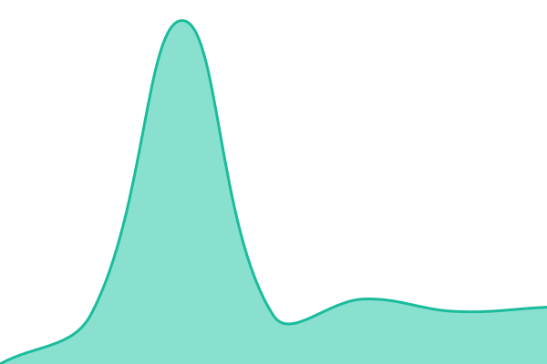
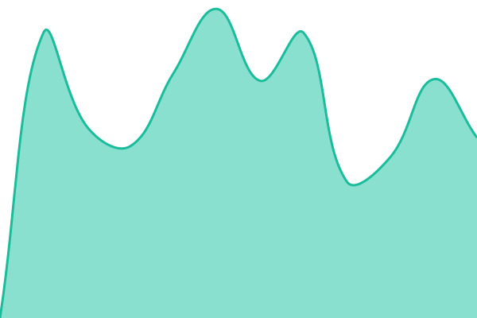
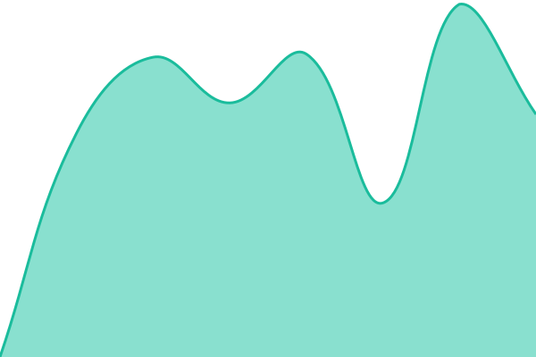
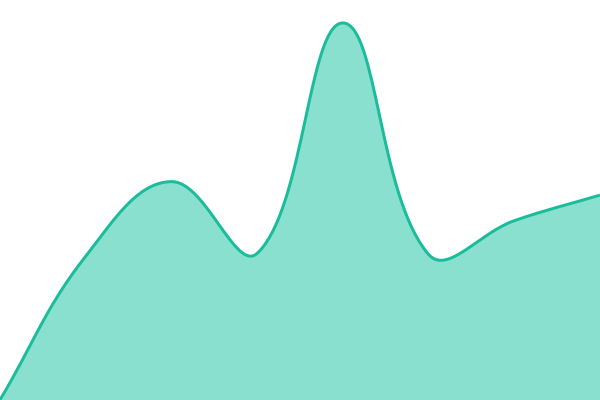

# [📈 Live Status](https://demo.upptime.js.org): <!--live status--> **🟩 All systems operational**

This repository contains the open-source uptime monitor and status page for [Hồ Sỹ Tú](https://demo.upptime.js.org), powered by [Upptime](https://github.com/upptime/upptime).

With [Upptime](https://upptime.js.org), you can get your own unlimited and free uptime monitor and status page, powered entirely by a GitHub repository. We use [Issues](https://github.com/hstu90/giam-sat-he-thong/issues) as incident reports, [Actions](https://github.com/hstu90/giam-sat-he-thong/actions) as uptime monitors, and [Pages](https://demo.upptime.js.org) for the status page.

<!--start: status pages-->
<!-- This summary is generated by Upptime (https://github.com/upptime/upptime) -->
<!-- Do not edit this manually, your changes will be overwritten -->
<!-- prettier-ignore -->
| URL | Status | History | Response Time | Uptime |
| --- | ------ | ------- | ------------- | ------ |
|  [Trung Vuong Shool](https://trungvuong.vn) | 🟩 Up | [trung-vuong-shool.yml](https://github.com/hstu90/giam-sat-he-thong/commits/HEAD/history/trung-vuong-shool.yml) | 

 3908ms
     
 | 

<a href="https://demo.upptime.js.org/history/trung-vuong-shool">100.00%</a>
    

|  [Trung Vuong Garden](https://trungvuonggarden.com) | 🟩 Up | [trung-vuong-garden.yml](https://github.com/hstu90/giam-sat-he-thong/commits/HEAD/history/trung-vuong-garden.yml) | 

 1559ms
     
 | 

<a href="https://demo.upptime.js.org/history/trung-vuong-garden">100.00%</a>
    

|  [Thời khóa biểu](http://tkb.trungvuong.vn) | 🟩 Up | [thoi-khoa-bieu.yml](https://github.com/hstu90/giam-sat-he-thong/commits/HEAD/history/thoi-khoa-bieu.yml) | 

 1731ms
     
 | 

<a href="https://demo.upptime.js.org/history/thoi-khoa-bieu">66.89%</a>
    

|  [Quản trị nội bộ](https://qtnb.trungvuong.vn) | 🟩 Up | [quan-tri-noi-bo.yml](https://github.com/hstu90/giam-sat-he-thong/commits/HEAD/history/quan-tri-noi-bo.yml) | 

 3048ms
     
 | 

<a href="https://demo.upptime.js.org/history/quan-tri-noi-bo">65.11%</a>
    

|  [Quản lý bán hàng](http://qlbh.trungvuong.vn) | 🟩 Up | [quan-ly-ban-hang.yml](https://github.com/hstu90/giam-sat-he-thong/commits/HEAD/history/quan-ly-ban-hang.yml) | 

 3613ms
     
 | 

<a href="https://demo.upptime.js.org/history/quan-ly-ban-hang">100.00%</a>
    

|  [Hướng dẫn sử dụng SmartCA](https://ca.trungvuong.vn) | 🟩 Up | [huong-dan-su-dung-smart-ca.yml](https://github.com/hstu90/giam-sat-he-thong/commits/HEAD/history/huong-dan-su-dung-smart-ca.yml) | 

 1639ms
     
 | 

<a href="https://demo.upptime.js.org/history/huong-dan-su-dung-smart-ca">84.46%</a>
    

<!--end: status pages-->

[**Visit our status website →**](https://demo.upptime.js.org)

## 📄 License

- Powered by: [Upptime](https://github.com/upptime/upptime)
- Code: [MIT](./LICENSE) © [Anand Chowdhary](https://anandchowdhary.com)
- Data in the `./history` directory: [Open Database License](https://opendatacommons.org/licenses/odbl/1-0/)
